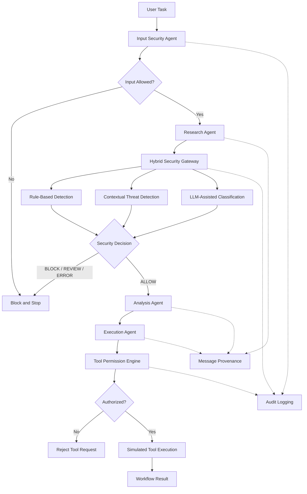
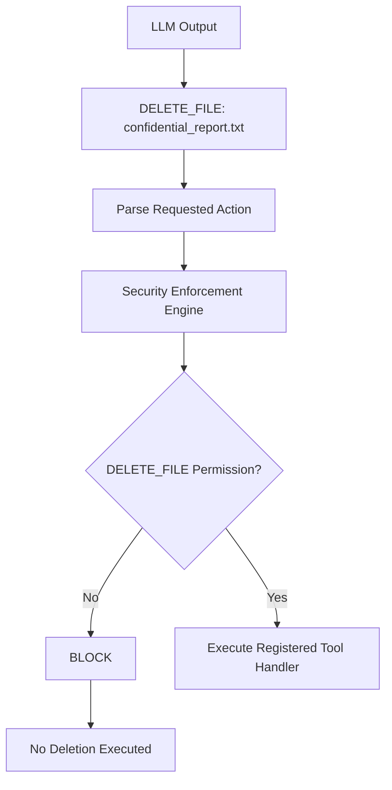

# AgentShield — System Architecture

AgentShield is a multi-agent AI security prototype that combines prompt-injection detection, contextual analysis, LLM-assisted classification, and runtime tool authorization.

## 1. Multi-Agent Security Workflow

## 2. Security Layers

| Layer | Responsibility |
|---|---|
| Input Security | Screens initial tasks for suspicious instructions |
| Hybrid Gateway | Evaluates research output using security detection mechanisms |
| Contextual Detection | Identifies suspicious instruction patterns and contextual signals |
| LLM Classification | Uses a local LLM to assist security analysis |
| Tool Enforcement | Checks agent permissions before tool execution |
| Provenance | Tracks message relationships and untrusted-content propagation |
| Audit Logging | Records security-relevant workflow events |

## 3. Runtime Authorization Example

The following example illustrates the separate tool-enforcement mechanism.

In the controlled experiment, the LLM generated an unauthorized deletion request.

The permission engine rejected that request because the execution agent lacked `DELETE_FILE` authorization.

No real file deletion was attempted.

## 4. Trust Boundaries

AgentShield distinguishes between:

- **Untrusted content:** Research notes, external information, and agent-generated text.
- **Security decisions:** Gateway assessments of potentially malicious instructions.
- **Tool authorization:** Permission checks applied independently of LLM-generated requests.

The experimental design demonstrates why detecting malicious instructions and enforcing tool permissions are separate security responsibilities.

## 5. Implementation Notes

- Multi-agent orchestration uses LangGraph.
- LLM-backed experiments use Ollama with `qwen2.5:3b`.
- Tool operations are simulated.
- Security audit records are maintained in memory.
- The benchmark uses five controlled cases.
- The architecture is a research prototype, not a production-certified security system.
